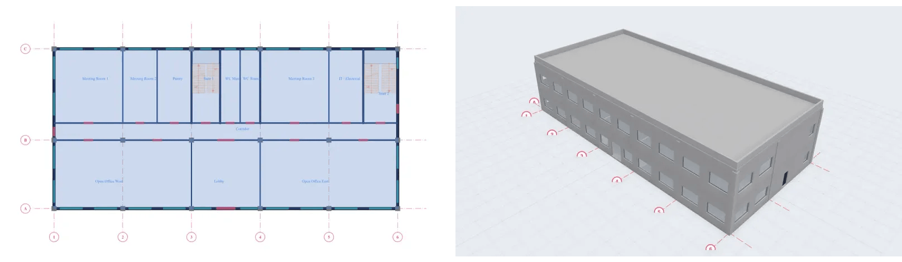

<p align="center">
  <picture>
    <source media="(prefers-color-scheme: dark)" srcset="assets/brand/bimdown-lockup-dark.png" />
    
  </picture>
</p>

# BimDown: an open, plain-text BIM format for people and AI agents

[](https://www.npmjs.com/package/bimdown-cli)
[](https://opensource.org/licenses/MIT)
[](https://github.com/NovaShang/BimDown/actions)

[中文文档](./README.zh-CN.md) · [Website](https://bim.jouledown.com) · [Examples](https://bim.jouledown.com/examples) · [Spec](./spec/) · [Agent skill](./agent-skill/SKILL.md)

**BimDown is an open, plain-text BIM format: a building is a folder of CSV attribute tables and GeoJSON (or SVG) geometry, one folder per level, that people, scripts and AI agents can read, edit, diff and query with SQL.**

This repository holds the format spec, the `bimdown` CLI (validate, build, render, SQL query, IFC import), the browser 2D/3D editor, a Revit 2025+ add-in and an agent skill for Claude Code, Codex, Cursor and other coding agents. The same format powers the free web app at **[bim.jouledown.com](https://bim.jouledown.com)**: describe a building with text, a sketch or photos, an AI agent builds a real BIM model you can edit in the browser, and you export plans, elevations, sections, 3D and IFC.

<p align="center">
  <a href="https://bim.jouledown.com/examples/small-office-building"></a>
  <br /><sub>The <a href="https://bim.jouledown.com/examples/small-office-building">small office example</a>: plan and 3D of one BimDown model. Open it in the browser, no sign-up.</sub>
</p>

## What can you do with it

- **Model buildings as text**: walls, doors, windows, rooms, slabs, roofs, stairs, columns, beams, foundations, ducts, pipes and more, as CSV rows plus GeoJSON lines and polygons.
- **Let an AI agent build or edit the model**: install the [agent skill](#use-with-ai-agents) and ask Claude Code, Codex, Cursor or Gemini CLI to draw a floor plan, then validate and render it.
- **Query a building with SQL**: `bimdown query` loads the model into DuckDB, with lengths, areas and bounding boxes computed from the geometry.
- **Render plans** to PNG or SVG from the command line, and check models (validation, room boundaries, MEP connectivity, clashes).
- **Version models in Git**: every change is a readable row-level diff; `bimdown diff` and `bimdown merge` work on whole projects.
- **Move between tools**: import IFC with the CLI, export IFC, glTF, DXF and PDF from the editor, and round-trip with Revit 2025+ through the add-in.
- **Edit in the browser**: open a local project folder in the [editor](https://bim.jouledown.com/editor) (2D/3D, plans, sections, elevations, sheets).

## Quickstart

Needs Node.js 20+. Create a project, add one room, check it and render the plan:

```bash
npx bimdown-cli@latest init my-building
mkdir my-building/lv-1 && cd my-building/lv-1

cat > wall.csv <<'EOF'
id,type_id
w-1,wt-concrete-200
w-2,wt-concrete-200
w-3,wt-concrete-200
w-4,wt-concrete-200
EOF
cat > wall.geojson <<'EOF'
{"type":"FeatureCollection","features":[
 {"type":"Feature","properties":{"id":"w-1"},"geometry":{"type":"LineString","coordinates":[[0,0],[6,0]]}},
 {"type":"Feature","properties":{"id":"w-2"},"geometry":{"type":"LineString","coordinates":[[6,0],[6,4]]}},
 {"type":"Feature","properties":{"id":"w-3"},"geometry":{"type":"LineString","coordinates":[[6,4],[0,4]]}},
 {"type":"Feature","properties":{"id":"w-4"},"geometry":{"type":"LineString","coordinates":[[0,4],[0,0]]}}]}
EOF
printf 'id,number,host_id,position,type_id\nd-1,D1,w-1,2.5,dt-single-900\n' > door.csv
printf 'id,x,y,name\nsp-1,3,2,Studio\n' > space.csv
cd ../..

npx bimdown-cli@latest validate my-building              # Build successful. No issues found.
npx bimdown-cli@latest build my-building                 # derives the room boundary (lv-1/space.geojson)
npx bimdown-cli@latest render my-building -o plan.png    # or -o plan.svg
npx bimdown-cli@latest query my-building "SELECT id, name, area FROM space"
```

`init` writes starter wall, door and window types (`global/*_type.csv`), which the rows above reference. The door sits 2.5 m along wall `w-1`; the room is a seed point whose boundary comes from the walls. For a bigger model, render the Revit-exported sample in this repository:

```bash
git clone --depth 1 https://github.com/NovaShang/BimDown.git && cd BimDown
npx bimdown-cli@latest info sample_data/rac_advanced
npx bimdown-cli@latest render sample_data/rac_advanced -l lv-1 -o plan.png
```

`@latest` runs the published CLI. To run the clone's own `cli/` source instead, `npm install` once at the repository root, then `npx bimdown-cli …` (it builds `cli/` on first use).

## Examples

Complete BimDown models you can open in the browser editor without an account. See [sample_data/README.md](./sample_data/README.md) for the data in this repository.

| Example | What it shows |
|---|---|
| [Small office building](https://bim.jouledown.com/examples/small-office-building) | 2-storey office: rooms, stair and WC core, columns, beams, flat roof |
| [Duplex apartment](https://bim.jouledown.com/examples/duplex-apartment) | buildingSMART's Duplex IFC test model, converted: foundations, roof, stairs, plumbing, electrical |
| [DigitalHub office, RWTH Aachen](https://bim.jouledown.com/examples/digitalhub-office-building) | A real office: basement plus 2 storeys, 64 rooms, structure, full ventilation ductwork |
| [Plant room and office (MEP)](https://bim.jouledown.com/examples/mep-plant-room) | AHU, chiller, pumps, cooling tower, connected ducts and pipes |
| [Photo to BIM](https://bim.jouledown.com/use-cases/photo-to-bim) | Use case: an AI agent builds an editable model from site photos |

## Use with AI agents

BimDown works with any agent that reads skills or custom instructions: **Claude Code**, **Codex**, **Cursor**, **Gemini CLI**, **VS Code with Copilot**, **OpenClaw**, **Antigravity** and others. The [skill](./agent-skill/SKILL.md) ([中文](./agent-skill-zh/SKILL.md)) teaches the schema, coordinate rules, modeling procedure and CLI usage.

Paste this into your agent:

> Install the BimDown CLI: `npm install -g bimdown-cli`. Download the skill file from https://raw.githubusercontent.com/NovaShang/BimDown/main/agent-skill/SKILL.md and install it to `<your-global-skill-directory>/bimdown/SKILL.md`.

Then ask for things like "draw a 2-bedroom apartment, 12 × 9 m", "find all walls thicker than 0.3 m" or "add a window to every room on lv-2". The agent writes CSV + GeoJSON, runs `bimdown build` until it is clean, and `bimdown render` to check the result visually.

To watch it work, open the project folder in [bim.jouledown.com/editor](https://bim.jouledown.com/editor) (Open local folder, Chrome or Edge): the agent's edits show up in 2D/3D within about 10 seconds, yours are written back to the folder, and nothing is uploaded.

## BimDown vs IFC

IFC (ISO 16739) is the industry standard for exchanging BIM data, and BimDown does not replace it. They suit different jobs:

| | IFC | BimDown |
|---|---|---|
| What it is | International exchange standard, supported by almost every BIM tool | An open format (MIT) from one project, read by its own tools |
| Structure | One file: a graph of entities linked by numeric references (STEP text) | A folder: one CSV table per element type plus GeoJSON geometry, per level |
| Detail | Any geometry and lifecycle data | About LOD 200: what, where and how big |
| Diff and review | Line diffs are hard to read | Row-level diffs in Git |
| Query | Needs a toolkit or a conversion | SQL over the model, built in |

In our own benchmark (October 2026), frontier LLMs did about equally well building models through IFC, BimDown and Revit toolchains, so the format alone does not make AI better at BIM. What BimDown adds is a lightweight model that the editor, the CLI and an agent all read and write directly, that diffs cleanly and answers SQL. Use IFC to exchange with other BIM software: `bimdown import-ifc` reads IFC2x3 and IFC4, and the editor exports IFC2x3 or IFC4.

## FAQ

**What is BimDown?**
An open, plain-text BIM format: a building is a folder of CSV attribute tables and GeoJSON (or SVG) geometry, one folder per level. It comes with a CLI, a browser editor, a Revit add-in and an agent skill, and powers the free web app at [bim.jouledown.com](https://bim.jouledown.com).

**Can ChatGPT, Claude or another AI create a BIM model?**
Yes. A coding agent with the BimDown skill and CLI writes the model files, validates them and renders plans to check its work. Without any setup, the [web app](https://bim.jouledown.com) has a built-in AI agent that builds an editable model from text, a sketch or photos.

**Is it free and open source?**
The format, CLI, editor, Revit add-in and skill in this repository are MIT-licensed. The web app is free to use; its editor works without an account.

**Can I convert IFC or Revit models to BimDown and back?**
IFC: `bimdown import-ifc model.ifc ./out` converts IFC2x3/IFC4 into a BimDown project, and the editor exports IFC (plus glTF, DXF and PDF). Revit 2025+: the add-in exports to BimDown and imports changes back into the original model. Anything outside the format's scope (see [below](#what-bimdown-cannot-represent)) is simplified, kept as a mesh or dropped.

**Is BimDown a replacement for Revit or IFC?**
No. It is a lightweight (about LOD 200) format for early design, existing buildings and AI workflows. Use Revit or another full BIM tool for construction-level detail, and IFC for exchange between BIM tools.

**Why CSV and GeoJSON instead of a binary or a single JSON file?**
Every language, spreadsheet, GIS tool and LLM already reads them. One table per element type keeps files small and diffs meaningful, and the tables load straight into DuckDB for SQL.

## Revit round-trip

The `revit-addin/` directory contains a C# add-in for Autodesk Revit 2025+ that syncs both ways between Revit models and BimDown:

- **Export**: Revit model -> BimDown (CSV + GeoJSON or SVG files)
- **Import**: BimDown -> Revit model
- **Round-trip**: export, edit with AI or by hand, import back; changes are applied to the original Revit model

**Install**: download the latest `BimDownInstaller.exe` from [GitHub Releases](https://github.com/NovaShang/BimDown/releases) and run it.

**Build manually (Windows)**:
```powershell
cd revit-addin
.\publish.ps1
```

## CLI

```bash
npm install -g bimdown-cli
```

Full reference: [cli/README.md](./cli/README.md) and `bimdown --help`.

### Project management

```bash
bimdown init ./my-project               # new project (--units m|mm|ft|in, default m) with starter types
bimdown build ./my-project              # validate and compute boundaries (writes fixes and space.geojson)
bimdown validate ./my-project           # the same checks, read-only
bimdown info ./my-project               # project summary (levels, element counts)
bimdown import-ifc model.ifc ./out      # convert an IFC2x3/IFC4 model into a BimDown project
```

### Querying

BimDown loads all CSV files into an in-memory DuckDB database, with geometry fields (length, area, start/end coordinates, bounding boxes) computed from the geometry layer. Query with standard SQL:

```bash
bimdown query ./my-project "SELECT id, material, length FROM wall"
bimdown query ./my-project "SELECT id, thickness FROM wall WHERE thickness > 0.3"
bimdown query ./my-project "SELECT level_id, COUNT(*) FROM door GROUP BY level_id"
bimdown query ./my-project "SELECT * FROM wall" --json
```

### Schema inspection

```bash
bimdown schema              # index of all element types (one line each)
bimdown schema wall         # fields for one element type
```

### Rendering

```bash
bimdown render ./my-project                     # render lv-1 to render.png
bimdown render ./my-project -l lv-3             # render a specific level
bimdown render ./my-project -o blueprint.svg    # SVG output (chosen by file extension)
```

### Checks, diffing and merging

```bash
bimdown resolve-topology ./my-project           # MEP: detect coincident endpoints, generate mep_nodes
bimdown mep-check ./my-project                  # MEP connectivity report
bimdown clash ./my-project                      # MEP clash detection
bimdown diff ./project-v1 ./project-v2          # structural differences (+, -, ~)
bimdown merge ./projectA ./projectB -o ./merged # merge projects, resolving ID conflicts
```

### Publishing and sync

```bash
bimdown publish ./my-project   # upload to bim.jouledown.com and get a share link
bimdown sync ./my-project      # hydrate into DuckDB, then write back to CSV + GeoJSON/SVG
```

## Quick look at the format

```
project/
  project_metadata.json         # format_version (1 = SVG, 2 = GeoJSON), project name, units
  global/
    level.csv                   # building levels
    grid.csv                    # structural grids
    wall_type.csv ...           # element types (optional)
  lv-1/
    wall.csv + wall.geojson     # walls (CSV attributes + geometry; .svg in a v1 project)
    door.csv                    # doors (CSV-only, parametric position on wall)
    slab.csv + slab.geojson     # floor slabs
    space.csv                   # rooms (seed point + name)
    ...
```

The CSV attribute layer is identical regardless of geometry encoding:

**wall.csv**
```csv
id,material,thickness
w-1,concrete,0.2
w-2,concrete,0.2
```

The geometry layer is either GeoJSON **or** SVG:

**wall.geojson** (`format_version: 2`, default)
```json
{
  "type": "FeatureCollection",
  "features": [
    { "type": "Feature", "properties": { "id": "w-1" },
      "geometry": { "type": "LineString", "coordinates": [[0,0],[10,0]] } },
    { "type": "Feature", "properties": { "id": "w-2" },
      "geometry": { "type": "LineString", "coordinates": [[10,0],[10,8]] } }
  ]
}
```

**wall.svg** (`format_version: 1`)
```xml
<svg xmlns="http://www.w3.org/2000/svg">
  <g transform="scale(1,-1)">
    <path id="w-1" d="M 0,0 L 10,0" />
    <path id="w-2" d="M 10,0 L 10,8" />
  </g>
</svg>
```

**door.csv** (no geometry file in either encoding; the position is parametric)
```csv
id,host_id,position,width,height,operation
d-1,w-1,3.0,0.9,2.1,single_swing
```

## Scope

BimDown is a **LOD 200 lightweight format**, aimed at early design and documenting existing buildings. It captures elements at the level of "what, where and how big", not "how exactly it is constructed".

Use BimDown when you need:
- AI agents to read, write and reason about building data directly
- Round-trip with Revit: export, edit (by a person or AI), import back
- Git version control and diffs for building models
- SQL queries over building data (via DuckDB)
- A lightweight interchange format between your own tools and scripts

Use Revit or another full BIM tool when you need:
- Construction-level detail (LOD 300+)
- Structural or MEP engineering calculations
- Full construction documentation and detailing

## Format spec

The full specification lives in [`spec/`](./spec/). Key concepts:

- **Units are declared per project** (`units` in `project_metadata.json`: m, ft, in, mm; default m), +Y = north
- **IDs are level-scoped**: unique within each `lv-N/` directory
- **Hosted elements** (doors, windows, openings) use `host_id` + `position` (distance from the wall start)
- **Spaces** are seed points; the boundary is derived from surrounding walls
- **Types**: optional `global/*_type.csv` catalogs (with layered wall, slab and roof assemblies); empty instance fields inherit the type's values
- **Materials** use a fixed enum: `concrete, steel, wood, clt, glass, aluminum, brick, stone, gypsum, insulation, copper, pvc, ceramic, fiber_cement, composite`
- **Geometry layer** is SVG **or** GeoJSON, selected by `format_version` (`1` = SVG, `2` = GeoJSON):
  - **GeoJSON** (default): `Point` / `LineString` / `Polygon` (no Multi\*); 2D and 3D coordinates; circular arcs via `properties.arc`
  - **SVG**: `<path>` (M, L, A commands), `<rect>`, `<circle>`, `<polygon>`; no Bezier curves; 2D only
- **Mesh fallback**: any element can have an optional `mesh_file` (GLB) for 3D visualization
- **MEP topology**: a graph of curves and nodes, resolved by the CLI

### Element types

| Category | Elements |
|---|---|
| Architecture | wall, column, slab, door, window, opening, space, stair (runs, landings), ramp, railing, curtain_wall, ceiling, roof, room_separator, furniture |
| Structure | structure_wall, structure_column, structure_slab, beam, beam_system, brace, foundation |
| MEP | duct, pipe, cable_tray, conduit, equipment, terminal, mep_node, mep_system, circuit |
| Documentation | view (sections), sheet, dimension, tag, text_note |
| Other | level, grid, element types, mesh (non-parametric fallback) |

## What BimDown cannot represent

These Revit scenarios fall outside BimDown's scope and are exported as `mesh` (GLB fallback), simplified or lost:

- **Free-form geometry**: conceptual masses, adaptive components, complex in-place families, NURBS
- **Non-circular curves**: elliptical or spline walls (circular arcs are supported)
- **Edited wall profiles**: non-rectangular wall elevations (e.g. gable walls with sloped tops)
- **Family logic**: instance parameters with formulas and constraints, nested families
- **Project organization**: phases, design options, arrays, worksets, linked models
- **Engineering analysis**: structural loads and rebar, MEP flow, pressure and load calculations
- **Site**: toposolids, property lines, site components

## Related

- **[BimDown web app](https://bim.jouledown.com)**: free AI BIM modeling and editing in the browser, with [examples](https://bim.jouledown.com/examples)
- **[Editor](editor/)**: the browser 2D/3D editor (React + Three.js) behind it, in this repository
- **[JouleDown](https://jouledown.com)**: the umbrella project BimDown is part of

## License

MIT
