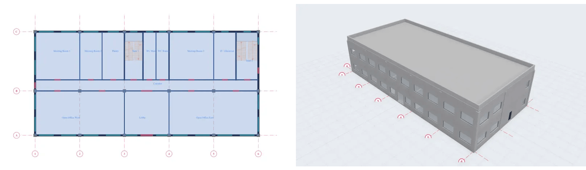

<p align="center">
  <picture>
    <source media="(prefers-color-scheme: dark)" srcset="assets/brand/bimdown-lockup-dark.png" />
    
  </picture>
</p>

# BimDown：人和 AI Agent 都能读写的开放纯文本 BIM 格式

[](https://www.npmjs.com/package/bimdown-cli)
[](https://opensource.org/licenses/MIT)
[](https://github.com/NovaShang/BimDown/actions)

[English](./README.md) · [官网](https://bim.jouledown.com/zh) · [示例](https://bim.jouledown.com/examples) · [格式规范](./spec/) · [Agent Skill](./agent-skill-zh/SKILL.md)

**BimDown 是一种开放的纯文本 BIM 格式：一栋建筑就是一个文件夹，用 CSV 属性表加 GeoJSON（或 SVG）几何描述，每个楼层一个子文件夹，人、脚本和 AI Agent 都能直接读写、对比差异、用 SQL 查询。**

本仓库包含格式规范、`bimdown` 命令行工具（校验、构建、渲染、SQL 查询、IFC 导入）、浏览器 2D/3D 编辑器、Revit 2025+ 插件，以及适用于 Claude Code、Codex、Cursor 等编程 Agent 的 Skill。同一格式也支撑着免费的在线应用 **[bim.jouledown.com](https://bim.jouledown.com/zh)**：用文字、草图或照片描述一栋建筑，AI 帮你建出真正的 BIM 模型，在浏览器里编辑，导出平面、立面、剖面、三维和 IFC。

<p align="center">
  <a href="https://bim.jouledown.com/examples/small-office-building"></a>
  <br /><sub><a href="https://bim.jouledown.com/examples/small-office-building">小型办公楼示例</a>：同一个 BimDown 模型的平面和三维。在浏览器中打开，无需注册。</sub>
</p>

## 能用它做什么

- **用文本描述建筑**：墙、门、窗、房间、楼板、屋顶、楼梯、柱、梁、基础、风管、水管等，都是 CSV 行加 GeoJSON 线和多边形。
- **让 AI Agent 建模或改模型**：安装 [Agent Skill](#配合-ai-agent-使用)，让 Claude Code、Codex、Cursor 或 Gemini CLI 画平面图，再校验和渲染。
- **用 SQL 查询建筑**：`bimdown query` 把模型载入 DuckDB，长度、面积、包围盒等由几何自动计算。
- **命令行渲染平面图**为 PNG 或 SVG，并检查模型（校验、房间边界、MEP 连通性、碰撞）。
- **用 Git 管理模型版本**：每处修改都是可读的行级差异；`bimdown diff` 和 `bimdown merge` 可对整个项目操作。
- **在工具之间流转**：CLI 导入 IFC，编辑器导出 IFC、glTF、DXF、PDF，通过插件与 Revit 2025+ 双向互通。
- **在浏览器里编辑**：用[编辑器](https://bim.jouledown.com/editor)打开本地项目文件夹（二维/三维、平面、剖面、立面、图纸）。

## 快速上手

需要 Node.js 20+。新建项目、加一个房间、校验并渲染平面图：

```bash
npx bimdown-cli@latest init my-building
mkdir my-building/lv-1 && cd my-building/lv-1

cat > wall.csv <<'EOF'
id,type_id
w-1,wt-concrete-200
w-2,wt-concrete-200
w-3,wt-concrete-200
w-4,wt-concrete-200
EOF
cat > wall.geojson <<'EOF'
{"type":"FeatureCollection","features":[
 {"type":"Feature","properties":{"id":"w-1"},"geometry":{"type":"LineString","coordinates":[[0,0],[6,0]]}},
 {"type":"Feature","properties":{"id":"w-2"},"geometry":{"type":"LineString","coordinates":[[6,0],[6,4]]}},
 {"type":"Feature","properties":{"id":"w-3"},"geometry":{"type":"LineString","coordinates":[[6,4],[0,4]]}},
 {"type":"Feature","properties":{"id":"w-4"},"geometry":{"type":"LineString","coordinates":[[0,4],[0,0]]}}]}
EOF
printf 'id,number,host_id,position,type_id\nd-1,D1,w-1,2.5,dt-single-900\n' > door.csv
printf 'id,x,y,name\nsp-1,3,2,Studio\n' > space.csv
cd ../..

npx bimdown-cli@latest validate my-building              # Build successful. No issues found.
npx bimdown-cli@latest build my-building                 # 推导房间边界（lv-1/space.geojson）
npx bimdown-cli@latest render my-building -o plan.png    # 或 -o plan.svg
npx bimdown-cli@latest query my-building "SELECT id, name, area FROM space"
```

`init` 会写入墙、门、窗等起步类型（`global/*_type.csv`），上面的行引用了它们。门位于墙 `w-1` 起点 2.5 m 处；房间是一个种子点，边界由墙推导。想看更大的模型，可以渲染本仓库里从 Revit 导出的示例：

```bash
git clone --depth 1 https://github.com/NovaShang/BimDown.git && cd BimDown
npx bimdown-cli@latest info sample_data/rac_advanced
npx bimdown-cli@latest render sample_data/rac_advanced -l lv-1 -o plan.png
```

`@latest` 运行已发布的 CLI。要运行克隆仓库里 `cli/` 的源码：先在仓库根目录 `npm install` 一次，再用 `npx bimdown-cli …`（首次运行时会自动构建 `cli/`）。

## 示例

可在浏览器编辑器中直接打开的完整 BimDown 模型，无需账号。本仓库自带的数据见 [sample_data/README.md](./sample_data/README.md)。

| 示例 | 内容 |
|---|---|
| [小型办公楼](https://bim.jouledown.com/examples/small-office-building) | 两层办公楼：房间、楼梯和卫生间核心筒、柱、梁、平屋顶 |
| [Duplex 双拼住宅](https://bim.jouledown.com/examples/duplex-apartment) | buildingSMART 的 Duplex IFC 测试模型转换而来：基础、屋顶、楼梯、给排水、电气 |
| [DigitalHub 办公楼（亚琛工业大学）](https://bim.jouledown.com/examples/digitalhub-office-building) | 真实办公楼：地下一层加地上两层、64 个房间、结构、完整通风管网 |
| [机房与办公（MEP）](https://bim.jouledown.com/examples/mep-plant-room) | 空调箱、冷水机组、水泵、冷却塔，以及连通的风管和水管 |
| [照片生成 BIM](https://bim.jouledown.com/use-cases/photo-to-bim) | 使用场景：AI Agent 根据现场照片建出可编辑模型 |

## 配合 AI Agent 使用

BimDown 适用于所有支持 Skill 或自定义指令的 Agent：**Claude Code**、**Codex**、**Cursor**、**Gemini CLI**、**VS Code + Copilot**、**OpenClaw**、**Antigravity** 等。[Skill](./agent-skill-zh/SKILL.md)（[English](./agent-skill/SKILL.md)）教会 Agent 数据模式、坐标规则、建模流程和 CLI 用法。

把以下内容粘贴给你的 Agent：

> 安装 BimDown CLI：`npm install -g bimdown-cli`。下载 Skill 文件 https://raw.githubusercontent.com/NovaShang/BimDown/main/agent-skill/SKILL.md ，并安装到 `<你的全局Skill目录>/bimdown/SKILL.md`。

然后就可以提出"画一套 12 × 9 m 的两居室""找出所有厚度超过 0.3 m 的墙""给 lv-2 每个房间加一扇窗"这样的要求。Agent 会写 CSV + GeoJSON，反复运行 `bimdown build` 直到没有问题，再用 `bimdown render` 目视检查结果。

想看着 Agent 建模：在 [bim.jouledown.com/editor](https://bim.jouledown.com/editor) 用"打开本地文件夹"打开项目目录（Chrome 或 Edge）。Agent 的修改约 10 秒内出现在二维/三维视图中，你的编辑会写回该文件夹，不会上传任何内容。

## BimDown 与 IFC

IFC（ISO 16739）是 BIM 数据交换的行业标准，BimDown 并不取代它。两者适合不同的事：

| | IFC | BimDown |
|---|---|---|
| 是什么 | 国际交换标准，几乎所有 BIM 软件都支持 | 一个项目的开放格式（MIT），由配套工具读写 |
| 结构 | 单个文件：用数字引用相连的实体图（STEP 文本） | 一个文件夹：每类构件一张 CSV 表加 GeoJSON 几何，按楼层分 |
| 精细度 | 任意几何与全生命周期数据 | 约 LOD 200：是什么、在哪里、多大 |
| 差异与审阅 | 行级差异难以阅读 | Git 中的行级差异 |
| 查询 | 需要工具包或先转换 | 内置 SQL |

在我们自己的评测（2026 年 10 月）中，前沿大模型通过 IFC、BimDown 和 Revit 三套工具链建模的表现大致相当，所以格式本身并不会让 AI 更擅长 BIM。BimDown 的价值在于：一个轻量模型，编辑器、CLI 和 Agent 都直接读写，差异清晰，可以用 SQL 查询。与其他 BIM 软件交换请用 IFC：`bimdown import-ifc` 可读取 IFC2x3 和 IFC4，编辑器可导出 IFC2x3 或 IFC4。

## 常见问题

**BimDown 是什么？**
一种开放的纯文本 BIM 格式：一栋建筑就是一个文件夹，用 CSV 属性表加 GeoJSON（或 SVG）几何描述，每个楼层一个子文件夹。配套有 CLI、浏览器编辑器、Revit 插件和 Agent Skill，并支撑免费在线应用 [bim.jouledown.com](https://bim.jouledown.com/zh)。

**ChatGPT、Claude 等 AI 能建 BIM 模型吗？**
能。装了 BimDown Skill 和 CLI 的编程 Agent 会写模型文件、校验，并渲染平面图检查自己的结果。不想配置的话，[在线应用](https://bim.jouledown.com/zh)内置 AI Agent，可以根据文字、草图或照片建出可编辑的模型。

**免费吗？开源吗？**
本仓库中的格式、CLI、编辑器、Revit 插件和 Skill 均为 MIT 许可。在线应用免费使用，编辑器无需账号。

**能把 IFC 或 Revit 模型转成 BimDown 再转回去吗？**
IFC：`bimdown import-ifc model.ifc ./out` 把 IFC2x3/IFC4 转成 BimDown 项目，编辑器可导出 IFC（以及 glTF、DXF、PDF）。Revit 2025+：插件可导出为 BimDown，并把修改导回原模型。超出格式范围的内容（见[下文](#bimdown-无法表达的内容)）会被简化、保留为 mesh 或丢弃。

**BimDown 能替代 Revit 或 IFC 吗？**
不能。它是轻量（约 LOD 200）格式，面向方案设计、既有建筑和 AI 工作流。施工级深度请用 Revit 等完整 BIM 工具，BIM 软件之间交换请用 IFC。

**为什么用 CSV 和 GeoJSON，而不是二进制或单个 JSON 文件？**
所有编程语言、电子表格、GIS 工具和大模型都能直接读它们。每类构件一张表，文件小、差异有意义，而且能直接载入 DuckDB 用 SQL 查询。

## Revit 双向互通

`revit-addin/` 目录包含一个适用于 Autodesk Revit 2025+ 的 C# 插件，在 Revit 模型与 BimDown 之间双向同步：

- **导出**：Revit 模型 -> BimDown（CSV + GeoJSON 或 SVG 文件）
- **导入**：BimDown -> Revit 模型
- **Round-Trip**：导出、用 AI 或手工编辑、导回，改动应用到原始 Revit 模型

**安装**：从 [GitHub Releases](https://github.com/NovaShang/BimDown/releases) 下载最新的 `BimDownInstaller.exe` 并运行。

**手动构建（Windows）**：
```powershell
cd revit-addin
.\publish.ps1
```

## CLI

```bash
npm install -g bimdown-cli
```

完整参考：[cli/README.md](./cli/README.md) 与 `bimdown --help`。

### 项目管理

```bash
bimdown init ./my-project               # 新建项目（--units m|mm|ft|in，默认 m），附起步类型
bimdown build ./my-project              # 校验并计算边界（写入修正和 space.geojson）
bimdown validate ./my-project           # 同样的检查，只读
bimdown info ./my-project               # 项目摘要（楼层、构件数量）
bimdown import-ifc model.ifc ./out      # 把 IFC2x3/IFC4 模型转成 BimDown 项目
```

### 查询

BimDown 把所有 CSV 载入内存中的 DuckDB 数据库，几何字段（长度、面积、起止坐标、包围盒）由几何层自动计算。用标准 SQL 查询：

```bash
bimdown query ./my-project "SELECT id, material, length FROM wall"
bimdown query ./my-project "SELECT id, thickness FROM wall WHERE thickness > 0.3"
bimdown query ./my-project "SELECT level_id, COUNT(*) FROM door GROUP BY level_id"
bimdown query ./my-project "SELECT * FROM wall" --json
```

### Schema 查看

```bash
bimdown schema              # 所有构件类型的索引（每类一行）
bimdown schema wall         # 某一构件类型的字段
```

### 渲染

```bash
bimdown render ./my-project                     # 渲染 lv-1 到 render.png
bimdown render ./my-project -l lv-3             # 渲染指定楼层
bimdown render ./my-project -o blueprint.svg    # SVG 输出（按扩展名决定）
```

### 检查、差异对比与合并

```bash
bimdown resolve-topology ./my-project           # MEP：检测重合端点，生成 mep_nodes
bimdown mep-check ./my-project                  # MEP 连通性报告
bimdown clash ./my-project                      # MEP 碰撞检查
bimdown diff ./project-v1 ./project-v2          # 结构差异（+、-、~）
bimdown merge ./projectA ./projectB -o ./merged # 合并项目，自动解决 ID 冲突
```

### 发布与同步

```bash
bimdown publish ./my-project   # 上传到 bim.jouledown.com 并获得分享链接
bimdown sync ./my-project      # 载入 DuckDB 后写回 CSV + GeoJSON/SVG
```

## 格式一览

```
project/
  project_metadata.json         # format_version（1 = SVG，2 = GeoJSON）、项目名称、单位
  global/
    level.csv                   # 建筑楼层
    grid.csv                    # 结构轴网
    wall_type.csv ...           # 构件类型（可选）
  lv-1/
    wall.csv + wall.geojson     # 墙（CSV 属性 + 几何；v1 项目里是 .svg）
    door.csv                    # 门（仅 CSV，参数化定位在宿主墙上）
    slab.csv + slab.geojson     # 楼板
    space.csv                   # 房间（种子点 + 名称）
    ...
```

无论用哪种几何编码，CSV 属性层完全相同：

**wall.csv**
```csv
id,material,thickness
w-1,concrete,0.2
w-2,concrete,0.2
```

几何层是 GeoJSON **或** SVG 二选一：

**wall.geojson**（`format_version: 2`，默认）
```json
{
  "type": "FeatureCollection",
  "features": [
    { "type": "Feature", "properties": { "id": "w-1" },
      "geometry": { "type": "LineString", "coordinates": [[0,0],[10,0]] } },
    { "type": "Feature", "properties": { "id": "w-2" },
      "geometry": { "type": "LineString", "coordinates": [[10,0],[10,8]] } }
  ]
}
```

**wall.svg**（`format_version: 1`）
```xml
<svg xmlns="http://www.w3.org/2000/svg">
  <g transform="scale(1,-1)">
    <path id="w-1" d="M 0,0 L 10,0" />
    <path id="w-2" d="M 10,0 L 10,8" />
  </g>
</svg>
```

**door.csv**（两种编码下都没有几何文件，位置是参数化的）
```csv
id,host_id,position,width,height,operation
d-1,w-1,3.0,0.9,2.1,single_swing
```

## 适用范围

BimDown 是 **LOD 200 级别的轻量格式**，面向方案设计和既有建筑记录。它记录构件"是什么、在哪里、多大"，而不是"具体怎么构造"。

适合使用 BimDown 的场景：
- AI Agent 直接读写和推理建筑数据
- 与 Revit 双向互通：导出、编辑（人工或 AI）、导回
- 用 Git 做建筑模型版本控制与差异对比
- 用 SQL 查询建筑数据（通过 DuckDB）
- 在自己的工具和脚本之间做轻量交换

适合使用 Revit 或其他完整 BIM 工具的场景：
- 施工级别的精细度（LOD 300+）
- 结构或机电工程计算
- 完整的施工图和详图

## 格式规范

完整规范在 [`spec/`](./spec/) 目录。核心概念：

- **单位由项目声明**（`project_metadata.json` 的 `units`：m、ft、in、mm；默认 m），+Y = 北
- **ID 按楼层隔离**：在每个 `lv-N/` 目录内唯一
- **宿主构件**（门、窗、洞口）使用 `host_id` + `position`（距宿主墙起点的距离）
- **空间**是种子点，边界由周围的墙推导
- **类型**：可选的 `global/*_type.csv` 类型目录（含墙、楼板、屋顶的分层构造）；实例留空的字段继承类型的值
- **材料**使用固定枚举：`concrete, steel, wood, clt, glass, aluminum, brick, stone, gypsum, insulation, copper, pvc, ceramic, fiber_cement, composite`
- **几何层**为 SVG **或** GeoJSON，由 `format_version` 选择（`1` = SVG，`2` = GeoJSON）：
  - **GeoJSON**（默认）：`Point` / `LineString` / `Polygon`（不支持 Multi\*）；二维和三维坐标；圆弧用 `properties.arc`
  - **SVG**：`<path>`（M、L、A 命令）、`<rect>`、`<circle>`、`<polygon>`；不支持贝塞尔曲线；仅二维
- **Mesh 回退**：任何构件可以附带可选的 `mesh_file`（GLB）用于三维显示
- **MEP 拓扑**：管线和节点组成的图，由 CLI 解析

### 构件类型

| 类别 | 构件 |
|---|---|
| 建筑 | wall, column, slab, door, window, opening, space, stair（梯段、平台）, ramp, railing, curtain_wall, ceiling, roof, room_separator, furniture |
| 结构 | structure_wall, structure_column, structure_slab, beam, beam_system, brace, foundation |
| MEP | duct, pipe, cable_tray, conduit, equipment, terminal, mep_node, mep_system, circuit |
| 图纸 | view（剖面）, sheet, dimension, tag, text_note |
| 其他 | level, grid, 构件类型, mesh（非参数化回退） |

## BimDown 无法表达的内容

以下 Revit 场景超出 BimDown 的范围，导出时会转为 `mesh`（GLB 回退）、被简化或丢失：

- **自由曲面几何**：概念体量、自适应族、形状复杂的内建族、NURBS
- **非圆弧曲线**：椭圆或样条墙（圆弧是支持的）
- **编辑过的墙轮廓**：非矩形墙立面（如带坡顶的山墙）
- **族逻辑**：带公式和约束的实例参数、嵌套族
- **项目组织**：阶段、设计选项、阵列、工作集、链接模型
- **工程分析**：结构荷载与钢筋、MEP 流量、压降和负荷计算
- **场地**：地形实体、用地红线、场地构件

## 相关项目

- **[BimDown 在线应用](https://bim.jouledown.com/zh)**：免费的浏览器 AI BIM 建模与编辑，附[示例](https://bim.jouledown.com/examples)
- **[编辑器](editor/)**：背后的浏览器 2D/3D 编辑器（React + Three.js），位于本仓库
- **[JouleDown](https://jouledown.com)**：BimDown 所属的总品牌

## 许可证

MIT
